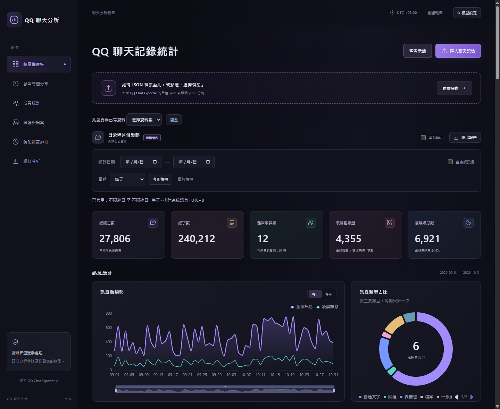

<div align="center">
  
  <h1>QQ 聊天分析</h1>
  <p>把 QQ 聊天記錄變成互動報告。看群組何時最熱鬧、誰聊得最多，以及大家都聊了什麼。</p>
  <a href="https://littlesurvival.github.io/qq-message-analysis/"></a>
  <p><sub>瀏覽器免安裝 · 支援 JSON / JSONL · 可離線分享報告</sub></p>
</div>



<div align="center"><sub>畫面使用內建示範資料。</sub></div>

## 功能亮點

| 發言趨勢 | 成員與媒體統計 |
| --- | --- |
| 從每日、每月趨勢、熱力圖和時段排行，找出群組最活躍的時間。 | 按訊息數、字數或檔案大小排序，查看成員的活躍時段、表情包與附件用量。 |
| **語料分析** | **報告分享** |
| 選擇模型後，可從資訊貢獻、建設性討論等八個面向探索聊天內容，並查看原文與評分理由。 | 開啟匿名顯示後分享 PDF、CSV、JSON 或離線互動 HTML。成員可單獨匯出個人 PDF。 |

## 開始使用

1. **開啟資料**：點「查看示範」，或匯入 [QQ Chat Exporter](https://github.com/shuakami/qq-chat-exporter) 的單檔 `.json` 或單個 `.jsonl` 分塊。
2. **套用篩選**：選擇日期與星期，圖表、排行與匯出報告都會更新，統一採用 UTC+8。
3. **查看或匯出**：點開成員看詳細統計，或從「匯出報告」下載想要的格式。

> **語料分析是選用功能。** 在「模型設定」連接 Ollama、llama.cpp、vLLM 或其他 OpenAI 相容服務後，點「開始新分析」。設定步驟可在介面內的「服務啟動說明」查看。

## 資料與隱私

統計在瀏覽器內計算，匯入檔案與分析紀錄保存在目前的瀏覽器。啟動語料分析時，待評分訊息與必要上下文會送到你選擇的模型服務。分享報告可開啟匿名顯示，互動 HTML 預設只保存統計。

## 本機開發與建置

需要 Node.js 22.12 或更新版本。

```sh
npm ci
npm run dev
```

使用 `npm run build` 建置靜態網站到 `dist/`。
